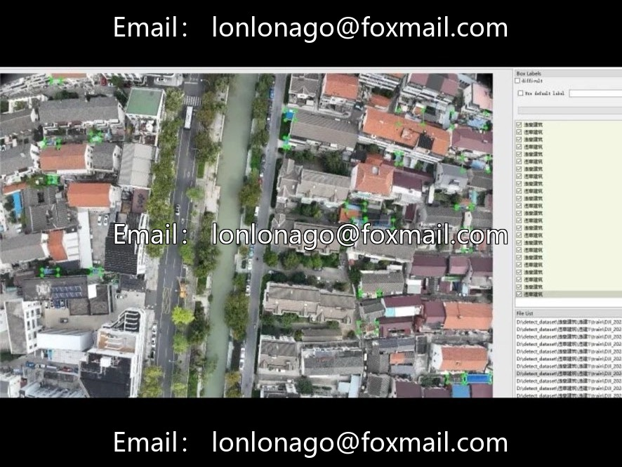
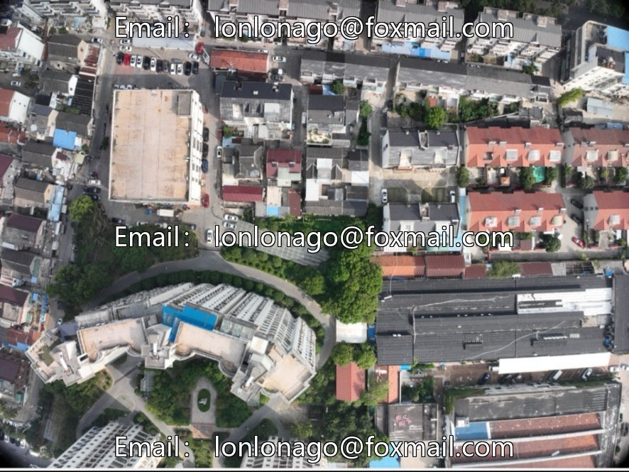
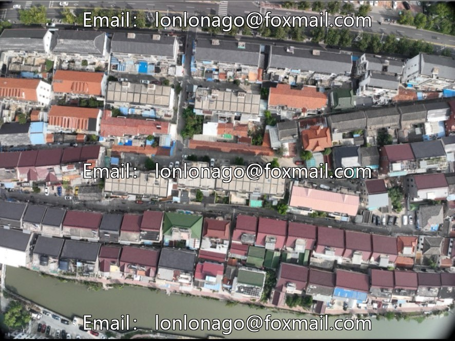
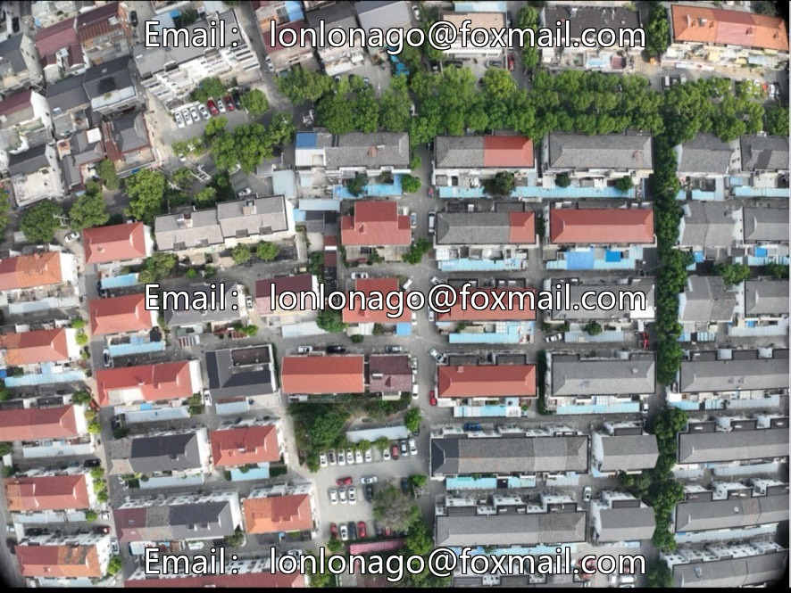

# Small UAV YOLO dataset for building violations, beginner course small sample materials, lightweight aerial photography

## Body

Small UAV YOLO dataset for illegal construction detection, beginner-friendly small sample materials for courses, lightweight aerial photography for detecting illegal buildings, suitable for beginners and small course projects✅

Core Parameters Quick Overview
▪️Total number of images: 200 high-altitude aerial photos
▪️Annotation format: Native YOLO txt, no need for format conversion
▪️Task objective: Identify various illegal constructions, temporary structures, and rooftop privately built structures
▪️Applicable scenarios: Fast training with small models, algorithm initial setup, basic experimental work for course projects

Data set highlights
Small sample size and lightweight, can quickly complete training even on low-end computers; YOLO format ready-to-use, eliminating the need for XML to txt conversion; Urban and rural aerial photography perspectives align with real scenes of natural resource inspection.

Application Fields
1. AI Beginner Learning: Target Detection Basic Process for Newcomers
2. Course Small Assignment: Simple Identification Project for Urban Construction/Surveying Specialties
3. Pre-experiment Testing: Use small datasets to debug the model before scaling up
4. Basic Verification of Low-altitude Drone Inspection Algorithm

Adaptation Directions
YOLO Beginner, Drone Small Object Detection, Smart City Supervision, Computer Vision Course Assignments, Simple Algorithms for Land Surveying

Virtual materials, once sold, are non-refundable.
Interested friends, click "I want" to proceed.

## Images

## Payment

Here is a pay link on Stripe ( https://buy.stripe.com/3cs8yP7sY87d0vu9AB ). Please contact me lonlonago@foxmail.com after funding $89, and I will send you a complete data files , thank you!

